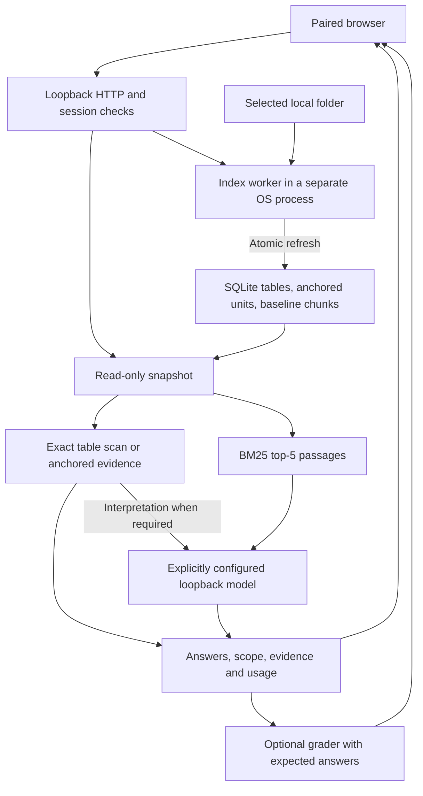

# Architecture

Fieldnote separates source parsing, query execution, language-model interpretation and evaluation. It uses a local SQLite database with FTS5. Installation requires no cloud services. The unit of comparison is one question executed twice against one committed snapshot.

| Boundary | Responsible code | Invariant |
|---|---|---|
| Browser and operating system | `app.py`, `static/app.js` | Bind to IPv4 loopback. A paired client supplies both a cookie and a per-instance header. Startup and shutdown authenticate the running instance before exchanging credentials. |
| Source files and parser | `index_worker.py`, `indexer.py` | Open ordinary selected files, skip hidden and linked entries, check archive limits, and restrict worker resources and environment. The worker reads sources and writes the index under the current user account. |
| Refresh and query | `indexer.py`, `engine.py` | A transaction publishes a new index generation. Failed individual files appear in the inventory. Fatal refresh failures roll back the transaction. A paired query reads a pinned snapshot. |
| Model and program | `provider.py`, `engine.py` | A model may propose a bounded structured operation. The executor validates table identity, columns, operators, values, and source references. It never executes model-authored SQL, shell commands, or scripts. |
| Answers and evaluation | `benchmark.py` | Only the grader sees reference answers. Every case contributes to the denominator. Raw value matches and coverage-qualified matches are reported separately. |

## Indexing

Each supported file has a source path, content digest, extraction state and issue list. Changed files replace their derived records. Spreadsheet cells retain typed values where the file provides them. Structured queries iterate the full selected table, while separate text indexes support anchored retrieval and passage-based RAG. The source anchors point into the indexed version. Originals must be retained separately to reproduce a historical source.

The refresh allows up to 25,000 inventory entries, 64 MiB per file, and 1 GiB of total source bytes. Office archives have limits on member count, expanded part size, and total expanded size. Worksheets have a ceiling of 250,000 rows and 1,024 columns. The worker has a ten-minute wall-clock deadline and a 1.5 GiB memory budget. Windows and Linux use OS limits. macOS samples resident memory, so short-lived peaks can exceed the target. These limits protect availability and do not constitute a permission sandbox.

## Query and model execution

A deterministic grammar handles common lookups and aggregates directly. A mixed question can use a passage describing a rule and an indexed spreadsheet in the same plan. An interpreted numeric comparison has to agree with supported explicit source wording. Blank or unparseable values can leave a result unresolved. The local scan has a cooperative deadline. A correct program can still implement the wrong interpretation of an ambiguous source.

Free-form document questions use ranked passages. Each evidence entry retains its anchor. The model receives untrusted source text as input and can return an answer or a typed proposal with references to the supplied entries. The RAG baseline uses the same synthesis instructions and configured provider over its own passage index. An incomplete selection cannot support an exhaustive table count. Check the reported scope and evidence before relying on a result.

Budgeting counts the rendered request with the model server's tokenizer where available. Admission removes complete optional passages, or declines a required plan that exceeds budget. Runtime usage comes from the response. Deterministic scans consume zero inference tokens. Indexing, disk I/O and tokenizer calls still consume machine resources.

## Operational recovery

The service owns only the model child it starts. A state lease protects against concurrent servers using the same working files. A stopped or failed worker releases its SQLite transaction. Benchmark reports are replaced atomically and shown only for their matching snapshot. Reindex after source changes, after changing parser versions, or when recovering from a version rollback. Use `--status` for instance verification and `scripts/smoke.py` to verify the installed HTTP path with synthetic data.
