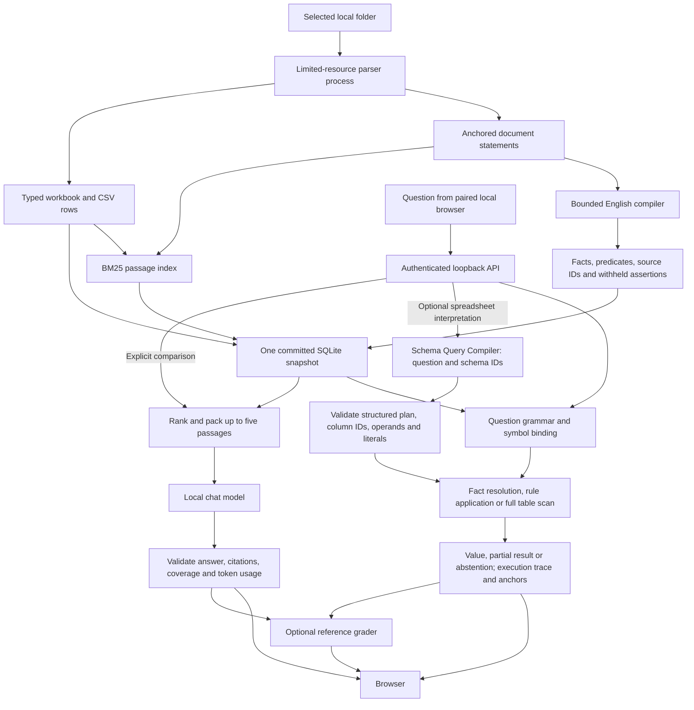

# Local Dataset Query Engine architecture

Local Dataset Query Engine interprets supported assertions when a source changes. Its default path resolves a fact or applies a typed operation without inference. For spreadsheet questions, the optional Schema Query Compiler uses a small local model to translate everyday language into a plan for the same row executor. A separate RAG baseline generates short answers from retrieved text.

## One policy through the system

1. A Markdown policy says a supplier requires escalation when its Review hours value is strictly greater than 48. The compiler records the entity, predicate, source locator, column, comparison operator and decimal threshold. The words “strictly greater” survive as the operator `>`.
2. “How many suppliers require escalation under the renewal policy?” binds the population to the supplier sheet and the predicate to the named policy. Competing bindings, unsupported conditions and conflicting values can cause an abstention.
3. The executor visits all 96 indexed rows for this workbook. A value of exactly 48 fails the predicate. Missing or invalid numeric values can produce a partial result. In the bundled data 38 rows satisfy the rule.
4. The browser shows the source, operator, scope and example row anchors. The examples illustrate how the computation was made. The reported count comes from the full scan.

## Components and contracts

| Component | Contract and failure behavior |
|---|---|
| Browser and HTTP boundary · `app.py`, `static/` | The single-user service binds IPv4 loopback. A paired tab supplies a session cookie and origin-scoped header. `POST /api/ask` defaults to `mode: "engine"`. Use `mode: "both"` for an explicit paired comparison. |
| Schema Query Compiler · `query_compiler.py`, `engine.py`, `provider.py` | Set `mode: "compiler"` or `"compiler_rag"`. Provide the local model with a bounded schema and the user's question. Constrain decoding to a JSON plan, validate the plan independently and execute it in the same snapshot. Supported operations cover one table, one optional projection and up to four conjunctive filters. |
| Source reader · `index_worker.py`, `indexer.py` | Discover ordinary files below the selected root. Skip hidden and linked entries. Decode supported formats, record digests, preserve document anchors and spreadsheet row coordinates, and report extraction issues. |
| Knowledge compiler · `knowledge.py` | Parse bounded declarative sentences into keyed scalar facts and numeric rules. Preserve the literal value, unit, source, and anchor. Recognized restricted scopes and unsupported clauses withhold assertions. An unsupported passage may reduce coverage across its source. |
| Snapshot store · `indexer.py` | SQLite stores source metadata, facts, rules, compilation gaps, typed rows and comparison passages. A refresh replaces changed or deleted source records transactionally. A changed compiler version requires reindexing. A reader pins a transaction before either method runs. |
| Binder and executor · `engine.py` | Bind a question to a symbol, table, column and operator through a fixed grammar. Require agreement among matched assertions. Apply equality, numeric comparisons, counts, sums, means, extrema and single-value lookups where supported. Only bound data reaches these operations. |
| Evidence and metering · `engine.py` | Fetch source excerpts for display after binding an assertion. Return the operation, bindings, coverage information and example anchors. The compiled route consumes zero model tokens. CPU, storage and extraction costs still apply. |
| Optional baseline · `engine.py`, `provider.py` | Retrieve up to five overlapping BM25 chunks from the same source extraction, including serialized spreadsheet rows. Pack within the input budget. A loopback chat model synthesizes a short answer and cites admitted passages. Report backend input/output usage and unmetered calls separately. |
| Evaluation · `benchmark.py`, `scripts/evaluate_*.py` | Keep labels outside the answering path. Distinguish answer accuracy, coverage, correct abstention, protocol failures and token usage. Support repeatable local workloads and a pinned external question slice. |

## Scope and integrity

The compiler recognizes a small English grammar. A value can be supported by an indexed source that is itself wrong. An exception in another document may be missed if its wording and scope are outside the grammar. A derivation demonstrates what the program computed over a particular snapshot. It does not independently establish that a source is true or that the index captures every applicable policy. Review exclusions in **Sources** and retain originals when historical reproducibility matters.

The current rule is a single numeric comparison over one table. Open-ended narrative synthesis, arbitrary multi-hop joins, temporal precedence, unit conversion and discovery of implicit exceptions remain open problems. Extending the system means adding operations with defined semantics, source binding, conflict handling and evaluation on unfamiliar data. Merely adding another query paraphrase can improve coverage without addressing a missing operation.

## Deployment and recovery

The parser runs under the caller's operating-system account in a separate process. An index refresh admits up to 25,000 inventory entries, 64 MiB per file and 1 GiB of source bytes. Office archives have entry and expansion limits. A worksheet is limited to 250,000 rows and 1,024 columns. The worker has a ten-minute deadline and a 1.5 GiB memory target. Windows and Linux enforce OS limits. macOS samples resident memory, which permits short peaks above the target. Protect the plaintext index and local report with OS permissions and disk encryption.

A state lease prevents two servers from writing to the same profile. A failed refresh rolls back its transaction. The app starts a managed model only on request and shuts down the child it owns. Reindex the selected folder after editing source files or upgrading the compiler. A saved report is shown only for a matching compiled snapshot. The HTTP smoke test exercises application startup, session pairing, indexing, querying and shutdown. [Security model](../SECURITY.md)
